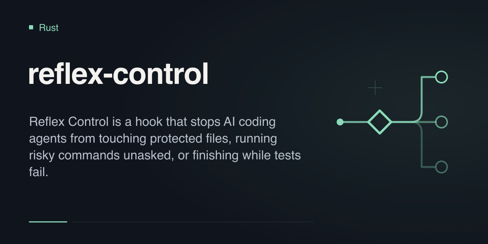
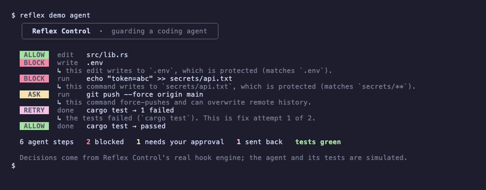
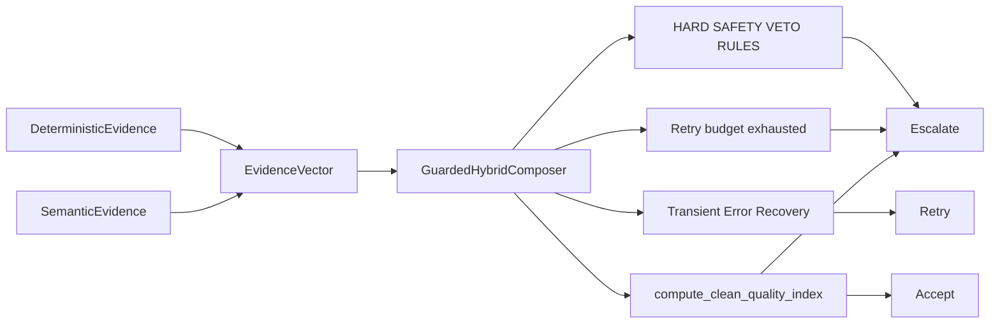

# Reflex Control



Reflex Control is a hook that stops AI coding agents from touching protected files, running risky commands unasked, or finishing while tests fail.

[](https://github.com/rustfuture/reflex-control/actions/workflows/ci.yml)
[](LICENSE)

> [!NOTE]
> **Status:** Research prototype (v0.5.0). Tested on synthetic fixtures; not production-validated.



- Blocks edits and shell writes to paths you protect (by default `.env`, `.env.*`, `*.pem`, `*.key`, `secrets/**`, `.github/workflows/**`, `migrations/**`; `.env.example` stays editable). It also catches `ln`, `curl -o`, `git checkout <file>`, `python -c` one-liners and heredocs.
- Blocks reads of secret files (`.env`, keys, `.netrc`, ...) so their contents do not reach the model provider. The agent can still use them: `source .env` and `--env-file .env` work ([secret reads](#secret-reads)).
- Asks you before destructive commands: 22 rules with stable ids, from `git reset --hard` and `rm -rf ~` to `DROP TABLE`, `terraform destroy` and HTTP `DELETE` requests ([destructive commands](#destructive-commands)).
- Stops the agent from editing Reflex Control's own settings and hook files ([self-protection](#self-protection)).
- Runs your test command when the agent says it is done; if the tests fail it sends the output back to the agent (2 retries by default), then asks you. It asks you early if a fix attempt leaves exactly the same failure, and it does not send the agent back if the test command cannot run.
- Installs into Claude Code, Cursor, Codex CLI, OpenCode, Kilo Code, Cline and pi with `reflex install` ([which ones ran in a real session](#agent-hooks)).
- Ships the decision library underneath: a policy that decides whether a task can finish, retry or escalate to a larger model, with calibration sweeps and SQLite telemetry ([how it works](#how-it-works)).

## Quick start

### Try the released CLI (macOS or Linux)

The prebuilt CLI does not require Rust. The installer downloads a release, checks its SHA-256 checksum, and installs to `~/.local/bin`:

```bash
curl -fsSL https://raw.githubusercontent.com/rustfuture/reflex-control/main/install.sh | sh
export PATH="$HOME/.local/bin:$PATH"
reflex --version
reflex demo agent
```

The demo shows Reflex Control guarding a simulated coding agent, without an API key or model download. Prebuilt Linux binaries require glibc; unsupported platforms can build from source. On Windows, use the [PowerShell installer](install.ps1).

<details><summary>Build from source</summary>

### Build from source

You need Git and Rust **1.88** or newer, including Cargo. Install the toolchain with [rustup](https://rustup.rs/); the first source build downloads Cargo dependencies.

### 1. Build

```bash
# Clone the repository
git clone https://github.com/rustfuture/reflex-control.git
cd reflex-control

# Build the workspace
cargo build --workspace
```

### 2. Run Offline Demos & Local Mock Execution

Evaluate decisions deterministically without external credentials or network calls:

```bash
# Run the verifier gate demo
cargo run --bin reflex -- demo verifier-gate

# Evaluate an individual task decision using the local mock provider
cargo run --bin reflex -- run --provider mock \
  --context "Check whether this worker patch is safe" \
  --risk low

# Run shadow mode on the benchmark fixture
cargo run --bin reflex -- shadow run

# Run Pareto frontier cost vs risk sweep
cargo run --bin reflex -- pareto
```

The CLI can also be installed to your cargo path via `cargo install --path crates/reflex-cli`, after which commands can be called directly as `reflex <subcommand>`.

### 3. Using Live TypeSafe Jev (Optional)

To evaluate tasks against live semantic signals using [TypeSafe Jev](https://typesafe.ai) (an API that scores task quality and safety), set `JEV_API_KEY`:

```bash
export JEV_API_KEY="your_api_key_here"

cargo run --bin reflex -- run --provider jev \
  --context "Add docstrings and verify the test suite" \
  --risk low
```

</details>

---

## Agent hooks

`reflex install` adds its hooks to each agent's own settings and keeps the hooks already there; `reflex uninstall` removes only its own entries. Per-agent details and limits: [docs/agent-hooks.md](docs/agent-hooks.md).

| Agent | Status |
| :--- | :--- |
| Claude Code | Run in real Claude Code sessions. 2026-10-02: protected writes were refused and failing tests sent the agent back ([record](docs/evidence/claude-code-live-2026-10-02.md)). 2026-10-22: reads of `.env`, a Python write to `.env` and an edit of `.reflex.toml` were denied, `git reset --hard` hit rule `git.reset-hard`, and a canary secret appeared 0 times in the transcript ([record](docs/evidence/claude-code-live-2026-10-22.md)) |
| Cursor | Built from secondary descriptions of Cursor's hooks; not run in a real session |
| Codex CLI | Checked against the Codex source; not run in a real session |
| OpenCode | Checked against the OpenCode source; not run in a real session |
| Kilo Code | Checked against the Kilo source; not run in a real session |
| Cline | Checked against the Cline source; not run in a real session |
| pi | Checked against the pi source; not run in a real session |

### Secret reads

An agent's reads go to the model provider. `protect.read` lists files it may not read. The default list is `.env`, `.env.*`, `*.pem`, `*.key`, `*.p12`, `*.pfx`, `secrets/**`, `id_rsa`, `id_ed25519`, `id_ecdsa`, `.netrc` and `.pgpass`. `.env.example`, `.env.sample` and `.env.template` stay readable.

The agent can use a secret without reading it:

```text
allowed:  source .env    set -a; . ./.env; set +a    docker compose --env-file .env up    wc -l .env
blocked:  cat .env    grep KEY .env    base64 < .env    cp .env /tmp/x    curl -d @.env URL    python3 -c "open('.env')..."
```

Blocked in every agent's shell: readers such as `cat`, `head`, `grep`, `sed`, `jq` and `base64`, input redirection, copies that carry the file elsewhere, uploads, `openssl -in`, and interpreter code that names a secret path. Also blocked, as tool calls: Claude Code `Read` and `Grep` (when `path` is a file), and OpenCode and Kilo Code `read`.

Not covered: the read tools of Cursor, Cline and pi (only their shell commands are checked), and `grep -r` over a directory that holds secrets. Loading a secret and printing it in the same command (`source .env && echo $API_KEY`) is blocked; printing it in a later, separate command is not seen. Details: [docs/agent-hooks.md](docs/agent-hooks.md#secret-reads).

To decide case by case instead, set `read_action = "ask"` under `[protect]`: Claude Code and Cursor then ask you before a secret read, and you can allow that one read. Agents that cannot ask still refuse it. A protected write is always blocked.

### Destructive commands

A catalog of 22 rules, each with a stable id such as `git.reset-hard`, `fs.rm-rf-broad`, `db.sql`, `container.prune`, `k8s.delete`, `iac.destroy`, `cloud.delete` and `http.delete`. A match asks you first (Claude Code, Cursor, pi); the reason ends with the rule id. Wrappers such as `sudo`, `env`, `npx` and `uv run` are seen through. Agents that cannot ask (Codex CLI, Cline, OpenCode, Kilo Code) refuse the command.

```bash
reflex check --rules     # list every rule and which ones this project allows
```

To stop asking for one rule, add its id to `.reflex.toml`. This never allows a write to a protected path:

```toml
[commands]
allow = ["git.reset-hard"]
```

### Check a command without running it

`reflex check` prints what the hooks would decide, using the project's `.reflex.toml`. It runs nothing. Exit code 0 is allow, 1 is ask, 2 is block.

```text
$ reflex check "git reset --hard"
ASK    command: git reset --hard
       this command throws away uncommitted changes (git reset --hard). Confirm before it runs (rule `git.reset-hard`).

$ reflex check --write .env --read README.md
BLOCK  write:   .env
       ...
ALLOW  read:    README.md
```

You can combine a command, `--write PATH` and `--read PATH` (the last two can be repeated). More in [docs/agent-hooks.md](docs/agent-hooks.md#reflex-check).

### Self-protection

An agent that can edit Reflex Control's settings can switch the guard off. With `protect.own_files = true` (the default) agents may not write `.reflex.toml`, `.reflex/**`, `.claude/settings.json`, `.claude/settings.local.json`, `.cursor/hooks.json`, `.codex/hooks.json`, `.git/hooks/**`, `.clinerules/hooks/**` or the OpenCode, Kilo Code and pi plugin files, and the matching user-level files under your home directory. Make those changes yourself. This also stops an agent from changing other settings in `.claude/settings.json`; set `protect.own_files = false` to turn the check off.

## How it compares

Reflex Control is a second layer, not a replacement for a sandbox. The table was written on 2026-10-22 from each project's public description; sources, dates and the gaps are in [docs/comparison.md](docs/comparison.md). "Not checked" means the sources do not say, not that the feature is missing.

| | Reflex Control | prove-it-mini, kora-agentgate | Claude Code built-in |
| :--- | :--- | :--- | :--- |
| Protected writes | Yes: path patterns with exceptions; edit tools and shell | No | Permission deny rules; the sandbox covers Bash |
| Secret reads | Yes: read tools in Claude Code, OpenCode and Kilo Code; shell commands in all | No | `Read(.env)` deny rules; sandbox `denyRead` |
| Destructive-command coverage | 22 rules, always on | No | Auto mode classifier; permission rules |
| Interpreter one-liners, heredocs | Yes, by heuristic | No | The sandbox covers child processes |
| Test gate at stop | Yes | **Yes: this is what they do** | No (write your own Stop hook) |
| Stuck-agent detection | Yes: same failure twice | Not checked | No test gate |
| Self-protection of own config | Yes | Not checked | Not checked |
| Explain or dry-run CLI | `reflex check` | Not checked | Not checked |
| Agents supported | 7, plus a git pre-commit hook | Claude Code | Claude Code |

prove-it-mini and kora-agentgate do one thing, block "done" while tests fail. Reflex Control's installer keeps hooks that are already in place. For hard allow and deny rules, Anthropic's hooks documentation recommends the Claude Code permission system, so use deny rules and the sandbox for those and Reflex Control for the rest.

## How it works

Reflex Control evaluates agent execution steps through a multi-layer decision pipeline:

- The engine collects deterministic signals (exit codes, test outcomes, changed files) and semantic signals (task completion, security risk, scope drift).
- A hard safety veto immediately escalates to a frontier model (a high-capability reasoning model) if the task modifies sensitive files, introduces security hazards, or exhausts retries.
- Transient errors with remaining retry budget trigger an autonomous retry rather than an expensive model call.
- Safe steps pass to a calibrated scoring gate that evaluates composite task quality against tuned thresholds.
- Steps meeting the quality threshold finish autonomously (`Accept` or `Terminate`), avoiding unnecessary calls to larger models.



---

## Workspace Architecture

The repository is organized as a Cargo workspace separating core abstractions from providers, policies, and tooling (see execution diagram in [`docs/architecture.md`](docs/architecture.md)):

| Crate | Path | Responsibility |
| :--- | :--- | :--- |
| `reflex-core` | [`crates/reflex-core`](crates/reflex-core) | Core data models, task contexts, evidence vectors, decision action enums. |
| `reflex-hooks` | [`crates/reflex-hooks`](crates/reflex-hooks) | Agent hooks: protected paths, shell-command checks, end-of-turn test runs, and the installer and adapter for each agent. |
| `reflex-provider` | [`crates/reflex-provider`](crates/reflex-provider) | Provider traits and local mock/synthetic implementations for zero-dependency runs. |
| `reflex-jev` | [`crates/reflex-jev`](crates/reflex-jev) | TypeSafe Jev API integration for atomic semantic signal extraction. |
| `reflex-policy` | [`crates/reflex-policy`](crates/reflex-policy) | Guarded Hybrid policy implementation, safety veto rules, and acceptance thresholds. |
| `reflex-telemetry` | [`crates/reflex-telemetry`](crates/reflex-telemetry) | SQLite-backed decision persistence, shadow-mode evaluation logs, cost and latency tracking. |
| `reflex-calibration` | [`crates/reflex-calibration`](crates/reflex-calibration) | Grid sweep routines for policy calibration, threshold optimization, and Pareto frontier generation. |
| `reflex-cli` | [`crates/reflex-cli`](crates/reflex-cli) | Unified CLI tool (`reflex`) for execution, benchmarks, shadow mode, and demos. |

---

## Runnable Examples

The repository includes standalone runnable examples under [`examples/`](examples/):

<details><summary>All examples</summary>

### Verifier Gate Example

Demonstrates both autonomous acceptance of safe tasks and hard safety veto rules against dangerous modifications (even when model confidence is high):

```bash
cargo run -p example-verifier-gate
```

Sample output:
```text
=== Reflex Control: Verifier Gate Example ===

--- Part 1: Policy Gate on Raw Observations ---
Task 1:     Fix typos in documentation
Risk:       low
Confidence: 0.96
Action:     accept
-> Policy skips a frontier verifier call (illustrative baseline: $0.02, 1,800 ms).

Task 2:     Execute DROP COLUMN users.auth_token migration
Risk:       critical
Confidence: 0.96
Action:     escalate
-> Safety rule: high and critical risk always escalate to verification, even at 0.96 confidence.

--- Part 2: Guarded Hybrid Architecture (Candidate E) ---
Clean Task Composite Quality: 0.74
Risk Score:                   0.08
Effective Action:             terminate
-> Clean execution finished autonomously without a frontier call.

Defect Task Quality:          0.85
Risk Score:                   0.90
Effective Action:             defer_to_frontier
-> Safety veto: the security risk was escalated even though tests passed.

=== All Verifier Gate examples completed successfully. ===
```

### Shadow Mode Sidecar Example

Demonstrates recording one mock prediction alongside a sample orchestrator action without mutating execution:

```bash
cargo run -p example-shadow-mode
```

### Agent Runtime Gate Example

Maps a runtime-style task result (exit status, timeout, verification result, changed files, retries left) to Accept / Retry / Escalate using the mock evidence provider, with no network access:

```bash
cargo run -p example-agent-runtime-gate
```

Sample output:
```text
=== Reflex Control: agent-runtime gate (offline, mock evidence) ===
verified fix                             -> accept (reflex action: terminate)
provider timeout, budget left            -> retry (reflex action: retry)
verification failing, budget exhausted   -> escalate (reflex action: defer_to_frontier)
green tests, secret file touched         -> escalate (reflex action: defer_to_frontier)
```

</details>

---

<a id="evaluation-benchmark--measured-results"></a>
## Evaluation Benchmark / Measured Results

**Live held-out result (0.3.0).** With thresholds frozen from a live-Jev calibration sweep (tau_accept 0.22, quality threshold 0.40, selected on the 40-task calibration partition), Candidate E was evaluated once with live Jev signals on the 100-task held-out partition: 0/43 false accepts among autonomous accepts and terminations, 0/31 missed frontier-required tasks, 1/69 unnecessary frontier calls, 66.0% autonomous action coverage, and 68.0% of frontier calls avoided. The generated report is committed as [`docs/experiments/live_heldout_results.md`](docs/experiments/live_heldout_results.md). Approximate two-sided 95% Wilson intervals are 0%–8.2% for 0/43 false accepts, 0%–11.0% for 0/31 frontier misses, 0.3%–7.8% for 1/69 unnecessary frontier calls, and 56.3%–74.5% for 66/100 autonomous actions. Live Jev signals vary slightly between calls: repeated calibration sweeps differed by one task in coverage at some grid points while selecting the same operating point, so a re-run can move these counts by a task or two. This is a single run on curated synthetic data, not production validation, and per-task predictions are not retained.

Historical Candidate E aggregates, partition history, and metric definitions are documented in [`docs/evaluation.md`](docs/evaluation.md).

---

## Datasets & Evaluation Fixtures

All fixture datasets and frozen policies reside in [`fixtures/`](fixtures/):

<details><summary>Dataset details</summary>

| Dataset File | Role | Sample Count |
| :--- | :--- | :---: |
| `fixtures/v2_eval_blind_test.json` | Curated synthetic held-out evaluation partition (legacy filename) | 100 tasks |
| `fixtures/v2_eval_calibration.json` | Systematic grid sweep split for threshold calibration ($\tau_{\text{accept}}, \theta_{\text{clean}}$) | 40 tasks |
| `fixtures/v2_eval_validation.json` | Architecture comparison split (Guarded Hybrid vs Deterministic Rules) | 30 tasks |
| `fixtures/v2_eval_dev.json` | Development & connectivity smoke testing split | 30 tasks |
| `fixtures/frozen_hybrid_config.json` | Frozen 0.3.0 policy parameters ($\tau_{\text{accept}} = 0.22, \theta_{\text{clean}} = 0.40, \text{risk}_{\text{frontier}} = 0.70$); fit with live Jev on the calibration partition | Config |

</details>

---

## Scope and Limitations

- **Synthetic fixtures:** Fixture datasets in [`fixtures/`](fixtures/) are synthetic scenarios generated via `docs/experiments/generate_v2_datasets.py` with fixed random seeds. They establish held-out split disjointness and threshold behavior under controlled conditions, not generalization to arbitrary production multi-tenant agent workloads.
- **Provider differences:** Offline evaluation via `--provider mock` uses deterministic heuristics and does not evaluate prompt language or contextual semantics. Live semantic evaluations require the TypeSafe Jev API (`JEV_API_KEY`), which introduces external network latency and minor sampling variation between runs.
- **Statistical bounds:** Zero observed false accepts or frontier misses on a 40-task or 100-task split indicate that no errors occurred in that sample, but statistical confidence bounds (e.g., Wilson intervals up to 8.2%–11.0%) reflect sample-size limits; zero observed errors do not establish zero risk.
- **Hook checks are heuristics:** The shell check reads command text. It does not run the command, expand variables or read script files, so it is a guard rail against mistakes, not a sandbox. Only Claude Code has been run in real sessions (headless, one model); the other agents are checked against source code or secondary descriptions. Limits per agent: [docs/agent-hooks.md](docs/agent-hooks.md).
- **Cost estimates:** Dollar savings and latency figures in demonstrations and synthetic benchmarks are calculated against assumed baseline costs ($0.02 / 1,800 ms per frontier call), not measured production bills.

---

## Tests

```bash
cargo test --workspace --all-targets
```

The test suite covers decision logic, security veto rules, threshold calibration, telemetry persistence, API integrations, and fixture split integrity. The hooks also run against a corpus of 188 shell commands with the expected verdict for each ([`guard_corpus.tsv`](crates/reflex-hooks/tests/fixtures/guard_corpus.tsv)), including a list of known gaps, a metamorphic test (rewrites that do not change a command must not change its verdict), a bypass matrix of the same dangerous act written another way ([`bypass_matrix.tsv`](crates/reflex-hooks/tests/fixtures/bypass_matrix.tsv)) and an adapter parity test. [docs/validation.md](docs/validation.md) reports what these measure, the hook's latency, and what happens on real agent traffic.

---

## License

This project is licensed under the [MIT License](LICENSE).
